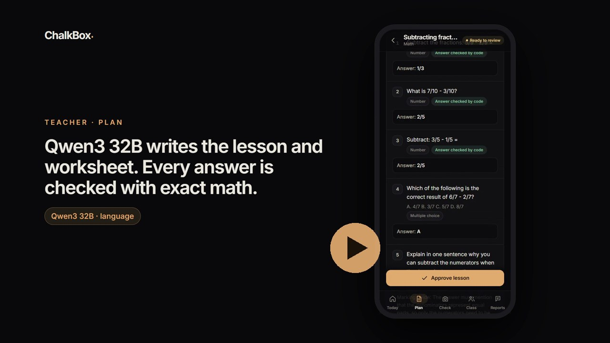

# ChalkBox

**Made for NVIDIA DGX Spark x SFBU hackathon**

An AI hub personalized for schools with no internet access. One NVIDIA DGX Spark in the
school runs everything; teachers and students use it from their phones over the school's
own Wi-Fi. No internet, no cloud, and student data never leaves the building.

[](docs/chalkbox-demo.mp4)

▶ **[Watch the 3-minute demo](docs/chalkbox-demo.mp4)**

## What it does

- **Plan:** a 5-part lesson and printable worksheet; every math answer is re-checked by code.
- **Check:** photograph handwritten worksheets. Gemma 3 4B reads them, code marks exact
  answers, Qwen3 32B judges written ones and explains each mistake. The teacher approves.
- **Follow up:** the class's most common mistakes, a practice sheet per student aimed at
  their own errors, and parent notes in each family's language.
- **Students:** their approved work and feedback, practice, progress, and a study assistant
  that gives hints (not answers), sticks to schoolwork, and flags worrying messages to the teacher.

## How it works

Three LangGraph workflows. Models read and write; code does anything that must be exact;
the teacher is a built-in approval step.

| Workflow | Steps |
|---|---|
| **Check** | read (Gemma 3 4B) → mark (code) → ⏸ teacher fixes unclear readings → grade written answers (Qwen3 32B) → diagnose + feedback |
| **Plan** | write lesson → write worksheet → verify answers in code (retry once) |
| **Follow-up** | practice sheet (answers verified by code) · or parent note |

**Stack:** React + Vite · FastAPI · LangGraph · SQLite · one OpenAI-compatible model client,
so the same code runs on a DGX Spark (vLLM / NIM), a cloud endpoint, or a laptop (Ollama).

## Quick start (Windows)

```powershell
# backend
cd backend
python -m venv .venv
.venv\Scripts\pip install -r requirements.txt
copy .env.example .env            # pick a model preset inside
.venv\Scripts\python -m scripts.seed --reset
.venv\Scripts\python -m uvicorn app.main:app --host 0.0.0.0 --port 8000

# frontend (separate terminal)
cd frontend
npm install
npm run build                     # the hub then serves the app at :8000
```

Open `http://localhost:8000`, or `http://<this-computer's-IP>:8000` from a phone on the same
Wi-Fi. API docs: `http://localhost:8000/docs`.

## Demo accounts

| Username | Password | Role |
|---|---|---|
| `dave` | `dave123` | Teacher (Grade 4A, 30 students) |
| `maya` | `maya123` | Student (Maya Johnson) |

Change these before using ChalkBox with a real class.

## Project layout

```
backend/    FastAPI hub: app/api (routes), app/graphs (LangGraph), app/grading.py (exact marking),
            app/helper.py (study assistant), scripts/ (seed, tests)
frontend/   React teacher + student app
docs/       demo video and thumbnail
```
